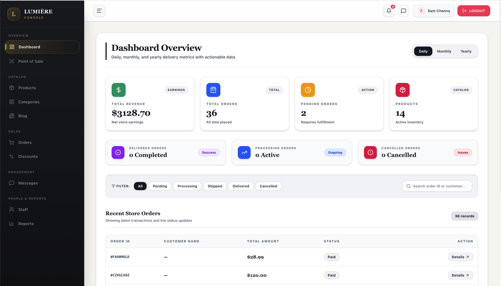
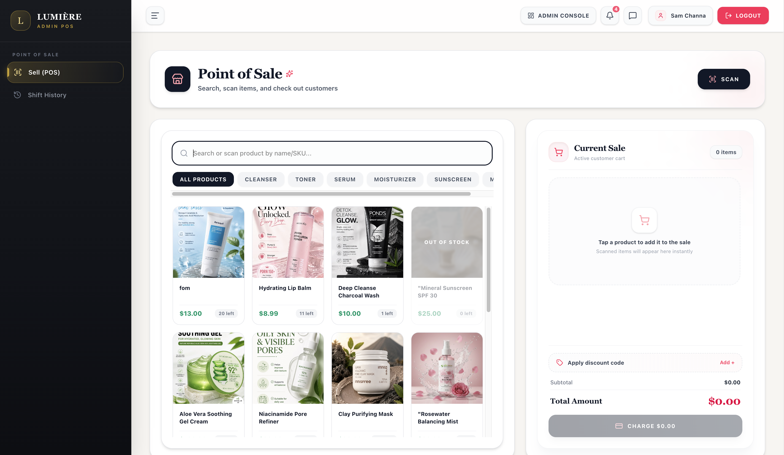

# 💄 Lumière — Skincare E-Commerce, Admin Dashboard & POS

A full-featured skincare e-commerce platform built with **React, Vite, and Firebase**, featuring a customer storefront, an admin dashboard, user and product management, and a staff Point of Sale (POS) system.

> ⚠️ **Practice / portfolio project.** All data is fake. Payments are simulated.

🔗 **Live Demo:** [Lumière Skincare](https://skincare-firebase.vercel.app)

---

## ⚠️ Demo Notice

- This is a demo with **fake data**. Data may be reset or deleted at any time.
- **Do not use real accounts.** Please don't register with your real email, phone number, address or password. Use the demo accounts below.
- **Payments are simulated.** The KHQR code uses a fake merchant ID, so no real payment can be made or confirmed. Please do not try to pay with a real bank app.
- Do not enter any real personal information.

---

## ✨ Features

### 🛍️ Customer Storefront

- **Home Page** — Hero banner, product categories, best sellers, special offers, and customer testimonials.
- **Shop** — Browse products with category filters, search, sorting, and grid/list views.
- **Best Sellers & New Arrivals** — Discover popular and newly added products.
- **Favorites / Wishlist** — Save favorite products.
- **Shopping Cart & Checkout** — Manage cart items and proceed through checkout.
- **My Orders** — View purchase history and track order status.
- **About, Blog & Contact** — Learn about the store, read articles, and contact the team.
- **Authentication** — Login, registration, and password recovery.

### 🧑‍💼 Admin Dashboard

- **Dashboard Overview** — View revenue, order statistics, product counts, and recent orders.
- **Product Management** — Create, update, and manage skincare products.
- **Category Management** — Organize products by category.
- **Order Management** — View orders and update their statuses.
- **Discount Management** — Manage promotional discounts.
- **Users Directory** — Search users, filter by role, and manage account roles.
- **Staff Management** — Manage Admin, Staff, and Customer permissions.
- **Blog & Messages** — Manage blog content and customer inquiries.
- **Reports** — View daily sales summaries.

### 🏪 Staff Point of Sale (POS)

- Search products by name or SKU.
- Add products to the cart and calculate totals in real time.
- Apply discount codes.
- Check stock availability and handle out-of-stock products.
- View shift history.
- Access online orders and customer messages.

### 🔐 Role-Based Access Control

The system supports three roles:

| Role | Description |
|---|---|
| **Admin** | Manages users, products, categories, orders, discounts, reports, and other administrative features. |
| **Staff** | Accesses authorized staff features, including the POS system. |
| **Customer** | Browses products, manages favorites and cart items, and accesses personal orders. |

Role-based route guards restrict access in the UI, and Firestore Security Rules and Cloud Functions enforce permissions on the server.

## 🔑 Demo Accounts

These are fake accounts for testing only.

| Role | Demo Email |
|---|---|
| Admin | `demoadmin@example.com` |
| Staff | `demostaff@example.com` |
| User (Customer) | `demouser@example.com` |

**How to access:**
1. Open the [Live Demo](https://skincare-firebase.vercel.app).
2. Navigate to the login page.
3. Enter the email of the role you want to test.
4. Use the demo password provided by the project owner (passwords are not published in this README).

> **Note:** Demo accounts depend on the Firebase configuration and may be reset or disabled at any time.

## 📸 Screenshots

### Admin Dashboard



### Customer Storefront


### Shop & Product Catalog


### Staff Point of Sale



## 🛠️ Tech Stack

- **React** — Component-based frontend development.
- **Vite** — Development server and build tooling.
- **React Router** — Client-side routing.
- **Firebase Authentication** — User authentication.
- **Cloud Firestore** — Database for application data.
- **Firebase Storage** — Image and file storage.
- **Cloud Functions (Node.js)** — Backend operations for authentication, orders, payments, and reports.
- **GitHub Actions** — Workflow automation for deployment.
- **Vercel** — Frontend hosting.

## ⚙️ Cloud Functions

| Area | Functions | Purpose |
|---|---|---|
| Authentication | `createStaffUser`, `deleteUserAccount`, `setUserRole` | Manage user accounts and roles. |
| Orders | `createOrder`, `cancelOrder`, `updateOrderStatus` | Handle order creation, cancellation, and status changes. |
| Payments | `generateKHQR`, `markOrderPaid`, `verifyPaymentWebhook` | Simulated KHQR generation and payment verification (demo only). |
| Reports | `dailySalesSummary` | Generate daily sales summaries. |

## 📁 Project Structure

```text
Skincare_Firebase/
├── functions/
│   └── src/                 # Firebase Cloud Functions
├── docs/
│   ├── admin-dashboard.png  # Admin dashboard screenshot
│   ├── home.png             # Storefront screenshot
│   ├── pos.png              # Staff POS screenshot
│   └── shop.png             # Shop screenshot
├── src/
│   ├── components/          # Shared UI, layouts, guards, POS
│   ├── context/             # Authentication, cart, and app state
│   ├── firebase/            # Firebase configuration
│   ├── hooks/               # Reusable data and application hooks
│   ├── pages/
│   │   ├── admin/           # Admin dashboard and management
│   │   ├── auth/            # Login, Register, Forgot Password
│   │   ├── staff/           # POS and shift history
│   │   └── users/           # Storefront and customer pages
│   ├── services/            # Application services
│   └── utils/               # Utility functions
├── firestore.rules          # Firestore security rules
├── storage.rules            # Storage security rules
├── firebase.json            # Firebase configuration
└── package.json
```

## 🚀 Getting Started

### 1. Clone the Repository

```bash
git clone https://github.com/Chana758/Skincare_Firebase.git
cd Skincare_Firebase
npm install
```

### 2. Configure Firebase

1. Create a project in the [Firebase Console](https://console.firebase.google.com/).
2. Enable Firebase Authentication, Cloud Firestore, and Firebase Storage.
3. Copy `.env.example` to `.env` and fill in your own Firebase web config.
4. Use a fake merchant ID for KHQR. Never use a real bank account.
5. Never commit `.env` or any private credentials to GitHub.

### 3. Run the Frontend

```bash
npm run dev
```

### 4. Deploy Cloud Functions

```bash
cd functions
npm install
firebase deploy --only functions
```

Make sure Firebase CLI is installed, you are authenticated, and the correct Firebase project is selected before deployment.

## 🔒 Security Notes

- Keep private credentials and sensitive configuration out of version control.
- Enforce authorization in backend operations, not only through frontend route guards.
- Protect privileged Cloud Functions and role-management operations.
- Use Firebase Security Rules to control access to Firestore and Storage.
- Only share demo credentials intended for public testing.

## 👤 Author

**Chana** — [GitHub @Chana758](https://github.com/Chana758)